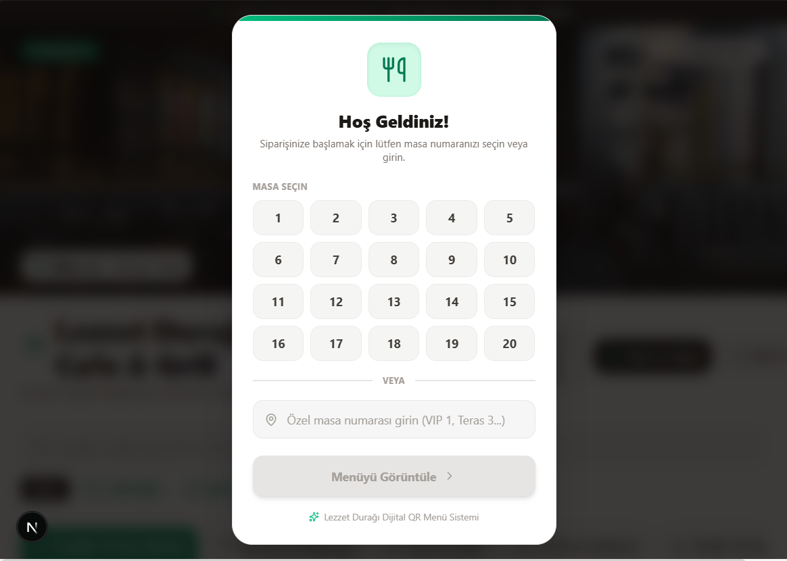
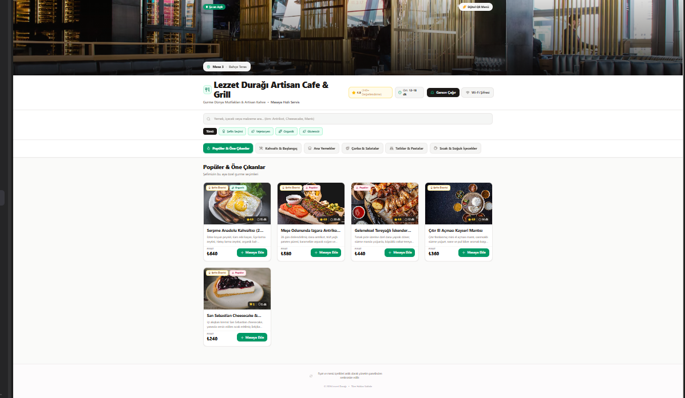
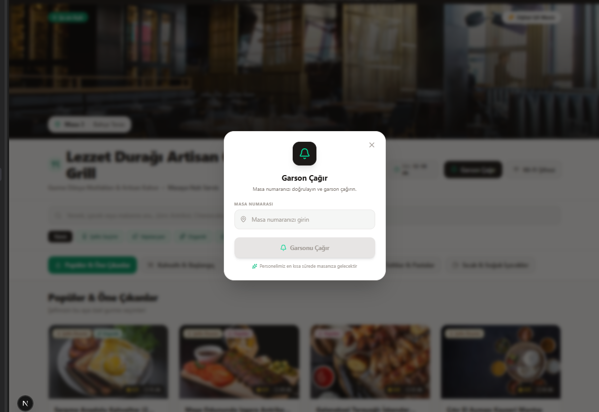
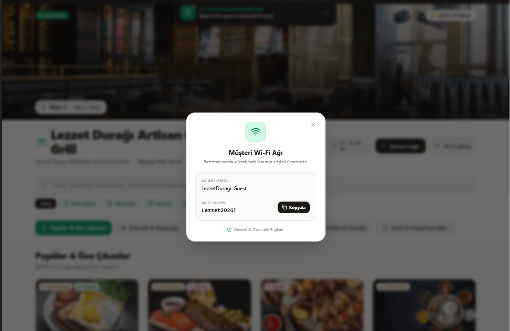
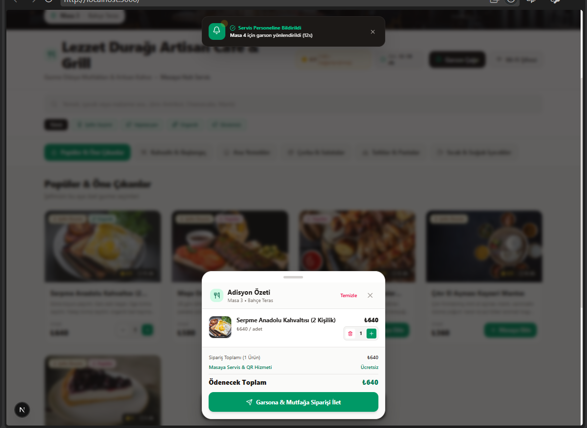
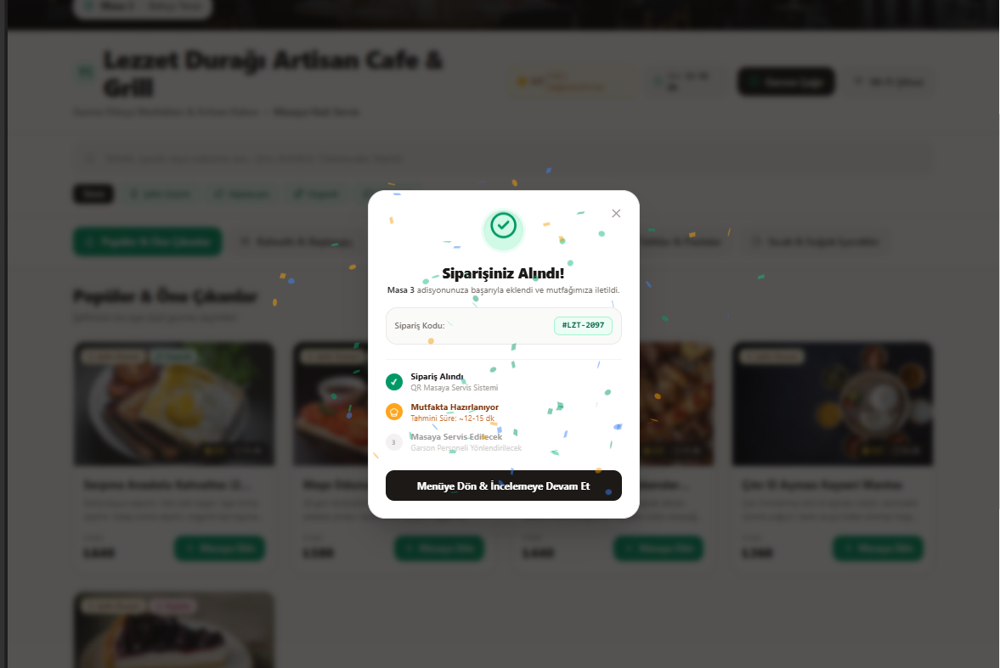
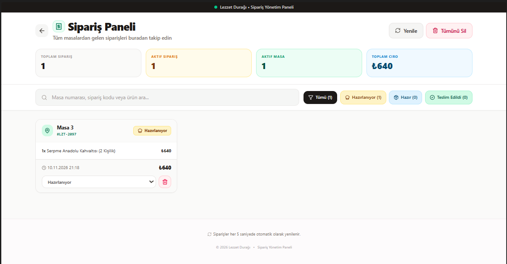

# QR Kod Menü Sistemi

**Lezzet Durağı** için geliştirilmiş, mobil öncelikli dijital menü ve sipariş takip arayüzü. Müşteriler QR koddan menüyü inceleyip sipariş oluşturabilir; işletme tarafı ise siparişleri `/panel` ekranından görüntüleyip durumlarını güncelleyebilir.

## Öne çıkanlar

- Masa seçimiyle başlayan mobil uyumlu menü deneyimi
- Kategori, metin araması ve rozet bazlı filtreleme
- Ürün detayları: açıklama, puan, hazırlama süresi, alerjenler ve ürün seçenekleri
- Sepete ürün ekleme, adet değiştirme, özel not ve tutar hesaplama
- Sipariş numarası oluşturma ve sipariş onayı
- Wi-Fi bilgilerini görüntüleme ve parolayı panoya kopyalama
- Garson çağırma bildirimi
- Sipariş yönetim panelinde arama, durum filtresi, özet istatistikleri ve sipariş durum güncelleme

## Ekran fotoğrafları

| Masa seçimi | Ana menü |
| --- | --- |
|  |  |

| Garson çağırma | Wi-Fi bilgileri |
| --- | --- |
|  |  |

| Adisyon özeti | Sipariş onayı |
| --- | --- |
|  |  |



## Teknolojiler

- [Next.js 16](https://nextjs.org/)
- React 19 ve TypeScript
- Tailwind CSS 4
- Framer Motion
- Lucide React ikonları

## Başlangıç

### Gereksinimler

- Node.js 20 veya daha güncel bir LTS sürümü
- npm

### Kurulum

```bash
git clone <depo-adresi>
cd qr-kod-menu-sistemi
npm install
```

### Geliştirme sunucusu

```bash
npm run dev
```

Tarayıcıda [http://localhost:3000](http://localhost:3000) adresini açın.

| Sayfa | Amaç |
| --- | --- |
| `/` | Müşteri menüsü ve sipariş oluşturma |
| `/panel` | Siparişleri izleme ve yönetme |

## Komutlar

```bash
npm run dev    # Geliştirme sunucusunu başlatır
npm run lint   # ESLint denetimini çalıştırır
npm run build  # Üretim derlemesi oluşturur
npm run start  # Üretim sunucusunu başlatır
```

## Yapılandırma

Örnek restoran, masa, Wi-Fi, kategori ve ürün verileri [`src/data/menu.ts`](src/data/menu.ts) içinde bulunur. Kendi işletmenize uyarlamak için bu dosyadaki aşağıdaki yapıları düzenleyin:

- `TABLE_INFO`: restoran adı, varsayılan masa, bölüm ve Wi-Fi bilgileri
- `CATEGORIES`: menü kategorileri
- `MENU_ITEMS`: ürün, fiyat, görsel, rozet, alerjen ve seçenek bilgileri

## Sipariş verisi hakkında

Siparişler sunucuya gönderilmez; tarayıcının `localStorage` alanında `lezzet-duragi-orders` anahtarıyla saklanır. Bu nedenle müşteri menüsü ile yönetim paneli **aynı tarayıcı ve aynı origin** üzerinde açıldığında aynı kayıtları görür.

Bu yaklaşım arayüz demosu için uygundur; gerçek bir QR menü kurulumu için siparişlerin farklı cihazlar arasında paylaşılabilmesi adına bir API, veritabanı ve kimlik doğrulama katmanı eklenmelidir.

## Proje yapısı

```text
src/
├── app/
│   ├── page.tsx          # Müşteri menüsü
│   └── panel/page.tsx    # Sipariş yönetim paneli
├── components/           # Menü kartları, modal pencereler ve sepet arayüzü
├── data/menu.ts          # Örnek restoran ve menü verileri
├── lib/orderStorage.ts   # Tarayıcı yerel depolama işlemleri
└── types/menu.ts         # TypeScript veri tipleri
```

## Lisans

Bu proje özel kullanım amacıyla hazırlanmıştır. Lisans koşulları belirlenmeden yeniden dağıtılmamalıdır.
